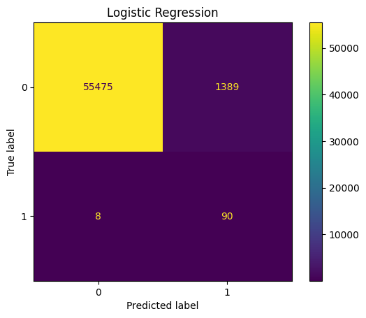
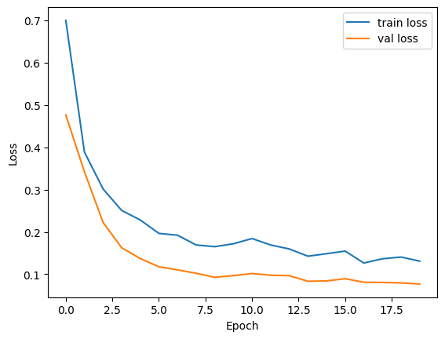
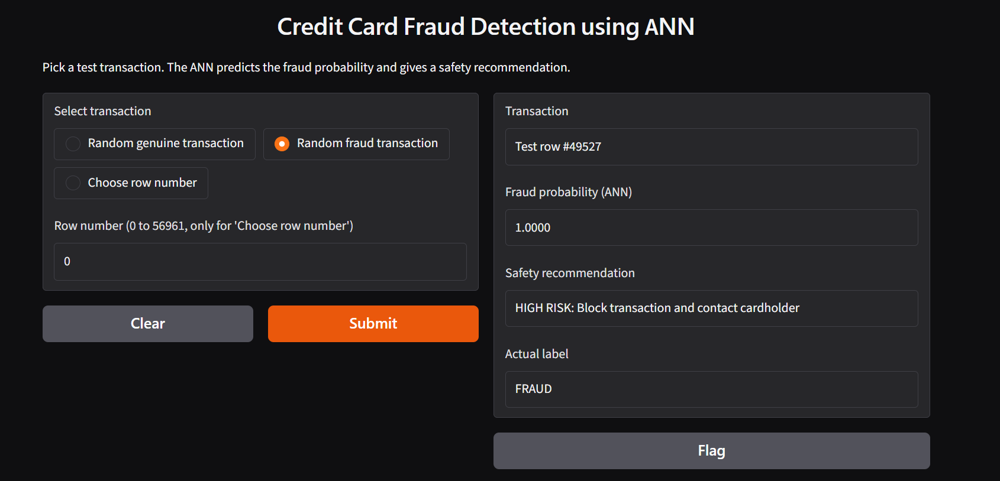
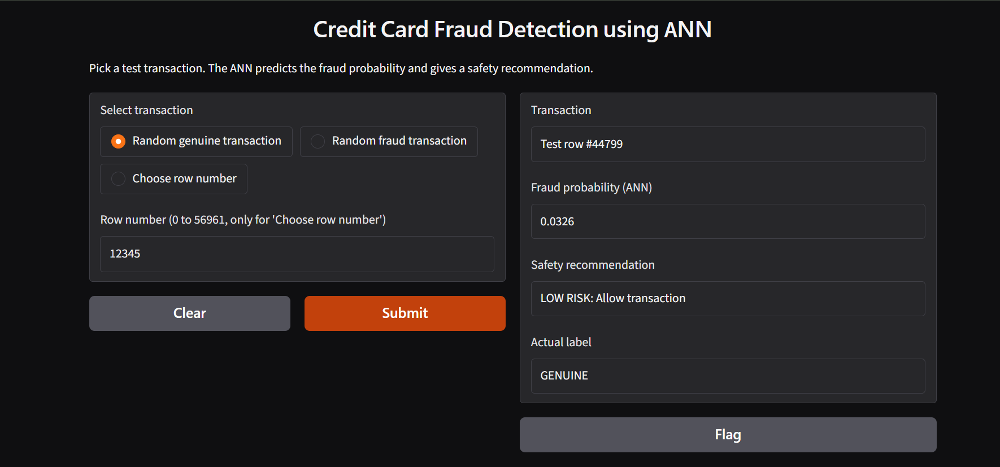

# Credit Card Fraud Detection and Safety Recommendation Using Artificial Neural Networks

An Artificial Neural Network (MLP) that predicts the probability that a credit card transaction is fraudulent, and turns that probability into a safety action: **Allow**, **Ask for OTP**, or **Block**.

Course project for *Neural Network and Fuzzy Logic*, Department of CSE, Southern University Bangladesh.

## Problem

Only about 0.17% of transactions in the dataset are fraud (492 of 284,807). A model that always predicts "not fraud" reaches about 99.8% accuracy and detects nothing, so accuracy is not used as the main metric. This project uses class weights during training and reports Precision, Recall, F1-score, ROC-AUC and PR-AUC.

## Dataset

[Credit Card Fraud Detection (Kaggle, ULB Machine Learning Group)](https://www.kaggle.com/datasets/mlg-ulb/creditcardfraud)

- 284,807 transactions, 492 fraud
- 30 features: `Time`, `Amount`, `V1` to `V28` (PCA-transformed, anonymized)
- Target: `Class` (0 = genuine, 1 = fraud)

The dataset file is about 150 MB, which is above GitHub's 100 MB file limit, so it is **not included**. Download `creditcard.csv` from the link above and place it next to the notebook.

## Method

1. Scale `Time` and `Amount` with `StandardScaler`
2. Stratified split: 80% train, 20% test
3. Class weights (balanced) to handle imbalance
4. Baseline: Logistic Regression
5. ANN (MLP) trained for 20 epochs
6. Evaluate on the test set (56,962 transactions, 98 fraud)
7. Threshold analysis and safety recommendation

## ANN architecture

```
Input (30) -> Dense 32 (ReLU) -> Dropout 0.3 -> Dense 16 (ReLU) -> Dropout 0.3 -> Dense 1 (Sigmoid)
```

Adam optimizer (learning rate 0.001), binary cross-entropy loss, batch size 2048, validation split 0.2. Total: 49 neurons, 1,537 trainable parameters.

## Results (test set, fraud class)

| Model | Precision | Recall | F1-score | ROC-AUC | PR-AUC |
|---|---|---|---|---|---|
| Logistic Regression (baseline) | 0.0609 | 0.9184 | 0.1141 | 0.9722 | 0.7189 |
| ANN (MLP) | 0.0778 | 0.9184 | 0.1434 | 0.9777 | 0.6888 |

Both models detect 90 of the 98 fraud cases. The ANN has fewer false alarms (1,067 vs 1,389) and higher Precision, F1 and ROC-AUC, while Logistic Regression has a slightly higher PR-AUC. ANN training is random, so numbers can differ slightly between runs.

| Logistic Regression | ANN (MLP) |
|---|---|
|  |  |



### Threshold analysis (ANN)

| Threshold | Precision | Recall | False alarms |
|---|---|---|---|
| 0.50 | 0.0778 | 0.9184 | 1,067 |
| 0.70 | 0.1740 | 0.8878 | 413 |
| 0.90 | 0.4503 | 0.8776 | 105 |
| 0.95 | 0.6562 | 0.8571 | 44 |
| 0.99 | 0.7257 | 0.8367 | 31 |

## Safety recommendation

| Fraud probability | Risk | Action |
|---|---|---|
| 0.90 or above | High | Block the transaction and contact the cardholder |
| 0.50 to 0.89 | Medium | Ask for OTP / extra verification |
| Below 0.50 | Low | Allow the transaction |

## Demo (Gradio)

The last notebook cell launches a small Gradio interface. Pick a random genuine transaction, a random fraud transaction, or a test row number, and it shows the fraud probability, the recommendation and the actual label.

| Fraud example | Genuine example |
|---|---|
|  |  |

## How to run

**Google Colab (easiest):** open `fraud_detection_ann.ipynb`, upload `creditcard.csv`, then Runtime > Run all.

**Local:**

```bash
pip install -r requirements.txt
jupyter notebook fraud_detection_ann.ipynb
```

## Repository structure

```
fraud_detection_ann.ipynb   notebook with code and outputs
requirements.txt
Lab_Report.pdf / .docx      lab report
Project_Proposal.pdf        project proposal
*.png                       result figures and demo screenshots
```

## Limitations

- Features V1 to V28 are anonymized, so the model cannot be explained in terms of real transaction attributes
- Data is from two days in 2013
- Test set has only 98 fraud cases, so small differences between models are not conclusive
- Only class weighting was used; SMOTE or undersampling were not explored

## Author

Afsana Akter Mina, Southern University Bangladesh
